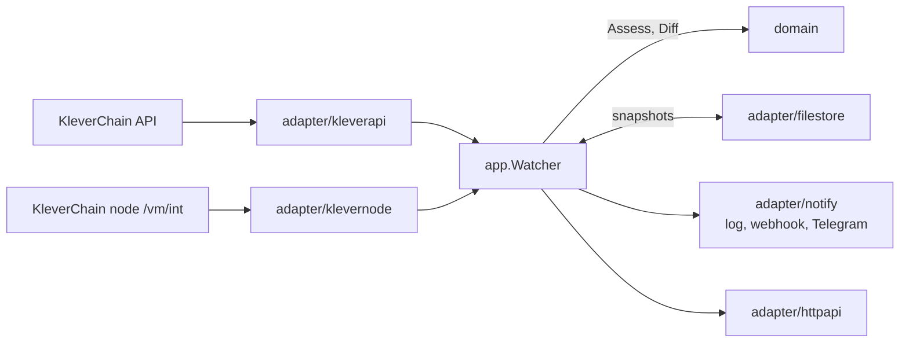

# permwatch

[](https://github.com/Amadeus-22/permwatch/actions/workflows/ci.yml)

Audits who can sign for a KleverChain account and alerts when that changes, because
a permission change moves no funds and so never trips a balance alert.

## Why

A KleverChain account can grant *permissions*: other keys that may sign for it,
alone or together, for a chosen set of operations. One `UpdateAccountPermission`
transaction from a phished owner or a compromised delegate can let a new key move
the funds or take over the account. Checking by hand means decoding a hex bitmask
per permission. permwatch decodes it, flags dangerous combinations and alerts on change.

## Quick start

Binaries (Linux/macOS, amd64/arm64) are on the
[releases page](https://github.com/Amadeus-22/permwatch/releases); the image is
`ghcr.io/amadeus-22/permwatch`. From source (Go version in `go.mod`):

```bash
make build                # bin/permwatch
make check                # go vet, gofmt, go test -race ./...
```

## Usage

| Command | Does | Exit `2` when |
|---|---|---|
| `permwatch audit [-api URL] [-json] <address>...` | One-shot report: permissions, signers, allowed operations, risk findings. | a critical or high finding |
| `permwatch vault [-node URL] [-warn 80] [-json] <contract>...` | Reads a spending-limit [vault contract](https://github.com/Amadeus-22/klever-contracts) and reports the period's usage. | usage reaches `-warn` % |
| `permwatch watch` | Service: polls accounts and vaults, alerts on change, serves an HTTP API. | — |

Defaults point at mainnet; add `-api https://api.testnet.klever.org` or
`-node https://node.testnet.klever.org` for testnet. Example audit (addresses shortened):

```
$ ./bin/permwatch audit -api https://api.testnet.klever.org klv1<owner>
klv1<owner>
  permission 0 (user) "treasury"  threshold 1  allows [Transfer]
    signer klv1<delegate>  weight 1
  permission 1 (owner) ""  threshold 1  allows any transaction
    signer klv1<owner>  weight 1
  [high] single_signer_moves_funds: permission "treasury" lets klv1<delegate> move value alone, with no second signature (Transfer)
```

Running the watcher:

```bash
cp .env.example .env      # set PERMWATCH_ADDRESSES or PERMWATCH_CONFIG_FILE
make run                  # or: docker compose -f deploy/docker-compose.yml up --build
curl localhost:8080/v1/accounts
```

A YAML watch list ([permwatch.example.yaml](permwatch.example.yaml)) gives each
account or vault a `label` and `owner` that show up in alerts, logs and the API.

## Rules

| Rule | Severity | Fires when |
|---|---|---|
| `foreign_owner` | critical | Keys other than the account's own can reach the **owner** permission's threshold. |
| `can_change_permissions` | critical | A **user** permission held by another key allows `UpdateAccountPermission`. |
| `single_signer_moves_funds` | high | One other key alone can `Transfer`, `Withdraw`, `Claim`, `AssetTrigger`, `Buy`, `Sell` or call a `SmartContract`. |
| `unknown_operations` | low | The bitmask grants contract types this version has no name for. |
| `vault_near_limit` | high | A vault reached its warning line or its limit in the current period. |

`watch` reports changes as `permission_added/removed`, `signer_added/removed`,
`weight_changed`, `threshold_lowered/raised`, `operations_widened/narrowed` and
`type_changed`. The first sighting of an account is stored as the baseline, with no alert.

## How it works



Dependencies point inward: `cmd` → `adapter` → `app` → `domain`. Key decisions, each with an ADR:

- **Poll account state, don't index transactions** ([0001](docs/adr/0001-poll-account-state.md)): the current state is the truth and needs no backfill after downtime; a change made and undone between two polls is missed.
- **JSON snapshot files, not a database** ([0002](docs/adr/0002-file-snapshots.md)).
- **Decode the operations bitmask locally**, without the chain's protobuf types ([0003](docs/adr/0003-local-bitmask-decoding.md)).
- **Vault alert levels kept in memory** ([0004](docs/adr/0004-vault-alert-levels-in-memory.md)): one alert at the warning line, one at the limit; a restart can repeat one.
- **At-least-once alerts**: a webhook or Telegram reply outside `2xx` leaves the stored state untouched, so the alert is retried next cycle.
- **Token amounts stay integers** in the smallest unit; never floating point.

Package map and failure modes: [docs/ARCHITECTURE.md](docs/ARCHITECTURE.md).

## Operating it

- **Config**: `PERMWATCH_*` environment variables, all validated at startup with every problem reported at once. Defaults and validation live in `internal/platform/config`; [.env.example](.env.example) has a starting set.
- **HTTP API**: `GET /v1/accounts`, `/v1/vaults`, `/healthz`, `/readyz` (`503` until the first pass finishes), `/metrics` (Prometheus: polls, changes, open findings by severity, last success time, vault usage).
- **Deploy**: Docker Compose (`deploy/docker-compose.yml`), an Ansible role installing a hardened systemd unit (`deploy/ansible/`), and a Helm chart (`deploy/helm/permwatch/`).

## Testing

- `make check` (what CI runs, plus `make build`): `go vet`, `gofmt`, unit tests with `-race`. Network adapters are tested against local `httptest` servers.
- `make test-integration`: reads a live testnet account (needs network).
- `deploy/ansible/test/run.sh`: runs the role twice against a systemd container; fails unless the second run changes nothing and `/healthz` answers. Run manually, not in CI.
- `deploy/helm/test.sh`: installs the chart in a kind cluster and checks readiness and the API. Run manually, not in CI.

Checked end to end on testnet: a real `UpdateAccountPermission` produced one webhook
alert and no repeats; a vault at 40% and 100% was reported correctly and alerted once.
Telegram delivery is tested only against a local server, not the real Bot API.

## Roadmap

1. Persist the vault alert level so a restart does not repeat an alert.
2. Flag owner-permission signers that have never sent a transaction.
3. KDA token vaults, once [klever-contracts](https://github.com/Amadeus-22/klever-contracts) supports them.

## License

MIT, see [LICENSE](LICENSE).
